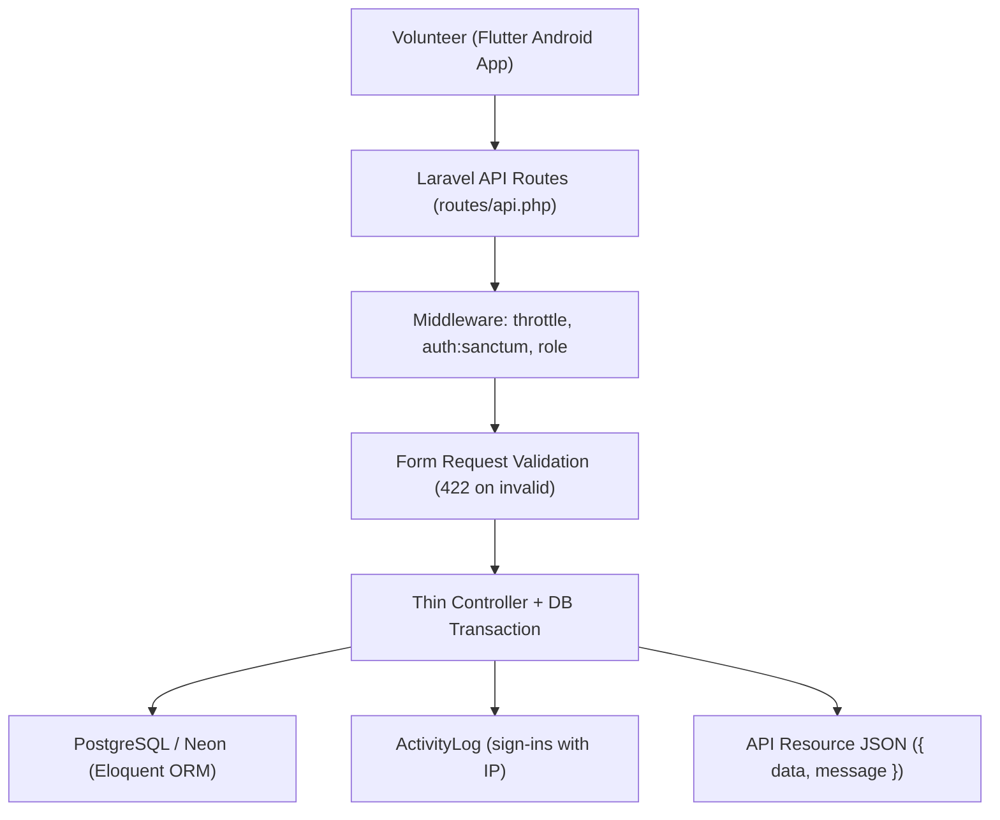
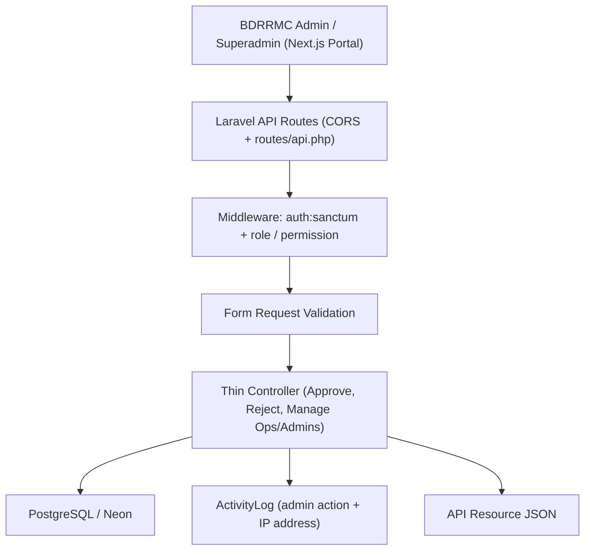
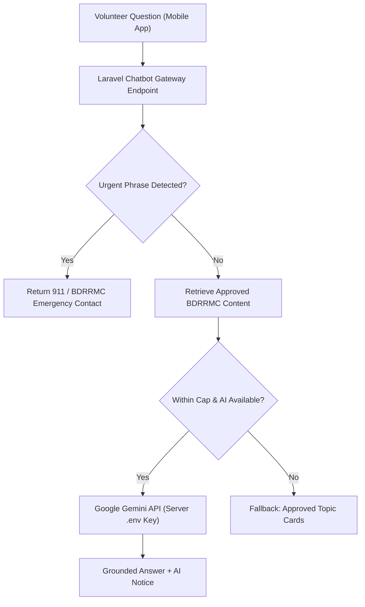

# E-Sagip — System Design Document

## Document Information

| Field | Details |
|---|---|
| **Project Name** | E-Sagip: Post-Disaster Volunteer Management System with an AI Chatbot for Barangay Santolan, Pasig City |
| **Prepared By** | Group 4 Capstone (DIT 3-3, PUP Institute of Technology) — John Felix T. Sungahid (PM), Spike Vincent M. Palagam & Euan Alfonso M. Suba (Backend), John Marvin O. Soleybar (Frontend / Mobile), Ryan Dexter J. Libres (UI/UX & Admin Frontend), Jhon Carl T. Gabarda (QA) |
| **Date Created** | November 28, 2026 |
| **Version** | 1.0 (Phase 2 Update) |
| **Document Status** | Living Document — Updated Every Phase |
| **Domains / Live URLs** | Backend API: https://e-sagip-santolan-api-1.onrender.com/api · Admin Portal: https://e-sagip-santolan-admin.vercel.app |

---

## Project Overview

E-Sagip is a post-disaster volunteer management system built for **Barangay Santolan, Pasig City** (population 61,308) and its **Barangay Disaster Risk Reduction and Management Committee (BDRRMC)**. Barangay Santolan regularly experiences severe riverine flooding (along Concepcion, Sgt. de Leon, Sto. Tomas, and Tawiran Streets) and high-density residential fires. Currently, post-disaster volunteer mobilization relies on social media messaging, phone calls, and manual logs, making it difficult to track volunteer availability, skills, operation slots, and verified participation.

E-Sagip solves these operational gaps through **two client interfaces sharing one Laravel REST API and one PostgreSQL database**:
- A **Flutter Android mobile application** for adult resident volunteers (18+) to register, browse open operations, confirm safety reminders, sign up within slot limits, check in/out, view participation history, read community information, and ask basic safety/app-help questions through the **E-Sagip Guide** AI chatbot.
- A **Next.js web-based admin portal** for authorized BDRRMC personnel to approve volunteers, manage operations, filter volunteers by skill/availability/area, confirm attendance, export/print rosters, publish community information, manage role-based access control (RBAC), and audit administrative actions.

E-Sagip supports and complements—but does not replace—the barangay's existing emergency response mandates, radio/phone/Messenger coordination, or official response agencies (BFP, DRRMO, 911).

---

## Project Measurements

### Objectives
- Build a shared **Laravel 13 (PHP 8.3)** REST API backed by **PostgreSQL** (local & Neon cloud) that serves both the Flutter mobile app and Next.js admin portal consistently.
- Digitize volunteer registration (with age 18+, Barangay Santolan residency, and RA 10173 privacy consent) and BDRRMC account approval workflows.
- Provide slot-controlled post-disaster operation management so volunteers can sign up safely after acknowledging hazard safety reminders, without exceeding slot limits.
- Track volunteer attendance through server-timestamped check-in/check-out codes (without GPS) and admin confirmation to compute verified participation hours.
- Centralize community disaster information (announcements, advisories, evacuation centers, emergency contacts, preparedness tips) and offer a grounded **E-Sagip Guide** AI chatbot limited strictly to barangay-approved content.
- Protect resident data under **Republic Act No. 10173 (Data Privacy Act of 2012)** using Sanctum token authentication, server-side RBAC, password hashing, rate limiting, and append-only activity logging.

### Scope
- **Volunteer Mobile App (Flutter, Android-first):** Registration & profile (skills, training, availability), login/logout, browse open operations, safety reminder confirmation, sign-up & cancel, My Tasks, code-based check-in/check-out, participation history & total hours, community info & emergency call button, and E-Sagip Guide AI chatbot.
- **BDRRMC Web Admin Portal (Next.js, desktop/tablet):** Admin login, RBAC management, volunteer approval queue (All/Pending/Approved/Rejected), volunteer search & filters (skill, availability, area), operation CRUD (create, edit, cancel, complete), operation sign-up lists, attendance confirmation & manual backup entry, dashboard summaries, CSV & printable rosters, community info management, and activity logs.
- **Shared Backend API & Database (Laravel + PostgreSQL/Neon):** Form Request validation, API Resources, Sanctum authentication, role/permission middleware, transactional slot locking, audit logging with IP address, CSV formula-injection protection, and server-side Gemini AI chatbot gateway.

### Limitations
- **Hazards covered:** Built around post-disaster recovery for **fire and flood** in Barangay Santolan; other hazards require new content.
- **Internet required:** No full offline mode; printable rosters and paper attendance sheets serve as manual fallbacks.
- **Android-first mobile client:** Shared as an installable APK for pilot testing; iOS is future work.
- **Self-reported skills:** Skills and training are self-reported by volunteers and reviewed by admins.
- **No GPS tracking:** Check-in/check-out uses operation codes and admin confirmation rather than GPS location tracking.
- **AI chatbot dependency:** Requires internet and an external AI service (Gemini), mitigated by a monthly usage cap and fallback to approved topic cards.
- **Free-tier hosting:** Render free tier sleeps after ~15 minutes idle; services are woken before pilot sessions.

### Out-of-Scope
- Disaster prediction, weather forecasting, early warning systems, or real-time emergency dispatch.
- Automatic SMS or push notifications.
- Document/ID file uploads or automated certificate verification.
- Relief goods or equipment inventory management and damage assessment.
- Direct integration with external government volunteer platforms (e.g., DSWD, OCD ACDV).
- Password reset / 2FA in early phases (parked/stretch per Project Plan Appendix B).

---

## User & Roles

| Role | Description |
|---|---|
| **Superadmin** (`superadmin`) | Authorized top-level BDRRMC administrator (first account created via Artisan CLI `esagip:create-superadmin`). Holds all permissions automatically and is the **only** role allowed to list, create, update, enable/disable, and assign permissions to admin accounts (`/api/admins*`). |
| **Admin** (`admin`) | Authorized BDRRMC personnel created by a Superadmin. Accesses only the web admin portal modules granted via `admin_permissions` (`volunteer_approvals`, `operation_management`, `attendance_confirmation`, `community_publishing`, `reports_exports`, `activity_logs`). Cannot use mobile volunteer login. |
| **Volunteer** (`volunteer`) | Barangay Santolan resident aged 18+ who self-registers on the mobile app (`status: pending`) and waits for admin approval (`approved` or `rejected`). Approved volunteers browse/join operations, check in/out, view their own participation history, read published community info, and use E-Sagip Guide. Has `permissions: []` and zero access to admin functions or other volunteers' contact details. |

---

## Functional & Non-Functional Requirements

### Functional Requirements

#### Authentication, Accounts & Access Control (Phase 2)
- **FR-01:** The system shall allow Barangay Santolan residents aged 18+ to register as volunteers (`status: pending`) with contact details, area, skills, optional training, availability, and explicit privacy consent (`consent_records`).
- **FR-02:** The system shall authenticate volunteers via `POST /api/login` and admins/superadmins via `POST /api/admin/login` using Laravel Sanctum Bearer tokens, enforcing role separation and `is_active` status.
- **FR-03:** The system shall allow any authenticated user to log out (`POST /api/logout`), revoking only the active token, and to view/update their own profile (`GET/PUT /api/me`).
- **FR-04:** The system shall allow admins with `volunteer_approvals` (or `superadmin`) to list/filter volunteers (with contact details restricted to admins only), view status summaries, and approve or reject (with optional reason) pending volunteers.
- **FR-05:** The system shall allow only `superadmin` users to list, create, edit, enable/disable, and manage permissions for admin accounts (`/api/admins*`), with the first superadmin created via Artisan CLI.
- **FR-06:** The system shall record every sign-in and administrative action in `activity_logs` including `user_id`, `action`, `module`, `details`, `ip_address`, and `created_at`.

#### Operations & Sign-Up Management (Phase 3)
- **FR-07:** The system shall allow authorized admins (`operation_management`) to create, edit, cancel, and mark post-disaster operations as completed, specifying title, description, location, schedule, required skills, and slot limit (≥ 1).
- **FR-08:** The system shall allow approved volunteers to browse open operations, confirm a safety reminder (`safety_acknowledgments`), sign up within slot limits (using transactional locking to prevent overbooking), and cancel before start.
- **FR-09:** The system shall derive `Ongoing` and `Full` operation states automatically, prevent duplicate sign-ups, and update volunteer `on_operation` availability.

#### Attendance & Participation History (Phase 4)
- **FR-10:** The system shall allow signed-up volunteers to check in and check out using an operation check-in code (recorded with server time, no GPS, no double check-in).
- **FR-11:** The system shall allow authorized admins (`attendance_confirmation`) to view/regenerate operation check-in codes, confirm or reject attendance records, and add manual attendance entries.
- **FR-12:** The system shall compute verified volunteer hours from confirmed records only, mark unrecorded sign-ups as `absent` when an operation is completed, and restrict volunteers to viewing only their own participation history.

#### Dashboard, Reports & Community Information (Phase 5)
- **FR-13:** The system shall provide admin dashboard summaries of operations, volunteer readiness, and approval queues.
- **FR-14:** The system shall allow authorized admins (`reports_exports`) to export UTF-8 CSV volunteer rosters and operation reports (protected against spreadsheet formula injection) and print rosters.
- **FR-15:** The system shall allow authorized admins (`community_publishing`) to create, publish, and archive announcements/advisories/alerts and manage evacuation centers, emergency contacts, and preparedness tips (with source and last-updated dates); volunteers see only published items.
- **FR-16:** The system shall allow authorized admins (`activity_logs`) to search, filter, and export audit log records.

#### E-Sagip Guide AI Chatbot (Phase 7)
- **FR-17:** The system shall provide a server-side chatbot gateway calling Google Gemini strictly grounded in BDRRMC-approved content, keeping the API key in the server `.env`.
- **FR-18:** The system shall display an "AI answers may be wrong" notice, detect urgent English/Filipino phrases to surface 911/BDRRMC emergency contacts, enforce rate limits and a monthly usage cap, fall back to approved topic cards when unavailable, and store no personal details or chat transcripts.

### Non-Functional Requirements (ISO/IEC 25010 & RA 10173)
- **NFR-01: FUNCTIONAL SUITABILITY** — Every API endpoint shall conform to `docs/api.md` (`{ data, message }` / `{ message, errors }`, `snake_case`, ISO 8601 dates) and be verified by PHPUnit Feature tests.
- **NFR-02: SECURITY** — All protected endpoints shall enforce Sanctum authentication and server-side role/permission middleware (`401`/`403`); passwords shall be hashed and follow minimum strength rules (8+ chars, letters + numbers); login/register routes shall be rate-limited (`429`).
- **NFR-03: DATA PRIVACY (RA 10173)** — Collect only minimal required fields, record informed consent (`consent_records`), restrict volunteer contact details to authorized admins, never log passwords/tokens, and use dummy data during development.
- **NFR-04: DATA VALIDATION** — Validate all inputs via Laravel Form Request classes before database writes, returning structured `422` responses without stack traces.
- **NFR-05: PERFORMANCE EFFICIENCY** — Filter columns (`role`, `status`, `is_active`, `availability`, `address_area`, `module`, `action`, `created_at`) shall be indexed, and list endpoints shall be paginated (`per_page` max 50).
- **NFR-06: RELIABILITY & FAILURE ISOLATION** — Failure of the external AI chatbot service shall never impact core volunteer/admin workflows; the app shall gracefully fall back to approved topic cards.
- **NFR-07: MAINTAINABILITY** — Follow thin controllers, Form Requests, API Resources, Eloquent models, PHP 8.3 compatibility, and never edit already-merged migrations.
- **NFR-08: AUDITABILITY** — Every sign-in and admin state-changing action shall create an append-only `activity_logs` entry with actor, action, module, details, IP address, and timestamp.
- **NFR-09: USABILITY & ACCESSIBILITY** — Mobile-first Android UI for volunteers and desktop/tablet web UI for admins, evaluated with ISO/IEC 25010 and System Usability Scale (SUS).
- **NFR-10: RECOVERABILITY** — Neon PostgreSQL backups and restore drills shall be verified prior to pilot deployment.

---

## System Architecture

### Modules

| Module | Requirements IDs | Description | Users |
|---|---|---|---|
| **Authentication & Access Control Module** | FR-01 — FR-03, FR-05 | Manages Sanctum tokens, volunteer registration, separate mobile/admin logins, logout, profile updates, and Superadmin-only RBAC management. | Volunteer, Admin, Superadmin |
| **Volunteer Management & Approval Module** | FR-04 | Lists, searches, and filters volunteers (contact details admin-only), provides status summaries, and approves/rejects pending accounts. | Admin (`volunteer_approvals`), Superadmin |
| **Operations & Sign-Up Module** | FR-07 — FR-09 | Manages post-disaster operations CRUD, safety reminder acknowledgments, and transaction-locked slot sign-ups/cancellations. | Admin (`operation_management`), Approved Volunteer |
| **Attendance & Participation Module** | FR-10 — FR-12 | Handles code-based check-in/check-out, admin confirmation/manual entry, and verified participation hours & history. | Admin (`attendance_confirmation`), Approved Volunteer |
| **Dashboard & Reporting Module** | FR-13 — FR-14 | Aggregates operational summaries and generates formula-safe UTF-8 CSV exports and printable rosters. | Admin (`reports_exports`), Superadmin |
| **Community Information Module** | FR-15 | Manages published announcements, advisories, evacuation centers, emergency contacts, and preparedness tips. | Admin (`community_publishing`), Volunteer (read-only) |
| **Activity Log / Audit Module** | FR-06, FR-16 | Records sign-ins and administrative actions with IP addresses for accountability and auditing. | Admin (`activity_logs`), Superadmin |
| **E-Sagip Guide AI Chatbot Module** | FR-17 — FR-18 | Server-side Gemini gateway grounded in BDRRMC-approved content with urgent-phrase escalation and topic-card fallback. | Volunteer, Admin (content review) |

---

## System Architecture Description

| Flow | Description |
|---|---|
| **MOBILE VOLUNTEER FLOW** | The Flutter Android app sends JSON requests with `Authorization: Bearer <token>` (stored in `flutter_secure_storage`) to the Laravel API. Routes validate input via Form Requests, enforce `auth:sanctum` and role checks, execute business logic via Eloquent models inside transactions, and return standardized API Resource JSON. |
| **ADMIN WEB PORTAL FLOW** | The Next.js admin portal authenticates via `/api/admin/login` (CORS-restricted to approved origins). Every admin endpoint checks `auth:sanctum` plus `role:superadmin` or `permission:<name>` middleware on the server so unauthorized roles always receive `403` regardless of frontend UI state. |
| **DATABASE & PERSISTENCE** | All structured records (`users`, `volunteer_profiles`, `skills`, `volunteer_skills`, `admin_permissions`, `consent_records`, `activity_logs`, plus Phase 3–7 tables) live in **PostgreSQL** (local PostgreSQL for dev, **Neon** for staging/production, in-memory SQLite for fast PHPUnit runs). No uploaded document blobs are stored. |
| **AUDIT / ACTIVITY LOGGING** | `ActivityLog::record()` writes append-only audit rows capturing `user_id`, `action`, `module`, `details`, `ip_address`, and `created_at` on every sign-in and admin action. Passwords and tokens are never logged. |
| **AI CHATBOT GATEWAY & ISOLATION** | Volunteer questions hit a dedicated Laravel chatbot endpoint (Phase 7) that retrieves BDRRMC-approved content and calls Google Gemini using a server-only `.env` key. If Gemini fails or hits the monthly cap, the API falls back to approved topic cards without affecting any core module. |

---

## System Architecture Diagrams

### Volunteer Mobile App Flow

### Admin Web Portal Flow

### E-Sagip Guide AI Chatbot Flow (Phase 7)

---

## Technological Stack

| Layer | Technology |
|---|---|
| **Mobile Presentation Layer** | Flutter (Dart), Provider, `http`, `flutter_secure_storage` |
| **Web Presentation Layer** | Next.js (React), plain JavaScript, plain CSS (hosted on Vercel) |
| **API & Business Logic Layer** | Laravel 13 (PHP 8.3+), Laravel Sanctum, Form Requests, API Resources, Middleware |
| **Persistence Layer** | Eloquent ORM / Laravel Query Builder |
| **Database Layer** | PostgreSQL (local & Neon cloud); SQLite `:memory:` for PHPUnit |
| **AI Service Layer** | Google Gemini API (called server-side via Laravel gateway in Phase 7) |
| **Hosting & DevOps** | Render (Docker, Apache + PHP 8.3), Neon (PostgreSQL), Vercel (Admin Portal), GitHub |
| **Testing & API Contract** | PHPUnit 12, `docs/api.md`, Postman Collection v2.1 |

---

## Project Feature Checklist (Phase 1 to Phase 8)

> Completed items are ~~crossed out~~ as each phase/milestone is finished.

### Phase 1: Project Setup and Foundation *(Completed)*
- ~~Create repositories (`esagip-api`, `esagip-mobile`, `esagip-admin`), protect `main`, and set up GitHub board & milestones~~
- ~~Confirm scope (Appendix A) and freeze initial design scope~~
- ~~Draft and approve ERD v1 (`docs/erd.dbml` / `docs/erd.png`)~~
- ~~Initialize Laravel API with Sanctum, standardized JSON error format, CORS, and `GET /api/health`~~
- ~~Deploy API to Render with Dockerfile connected to Neon PostgreSQL~~
- ~~Initialize Flutter mobile shell & Next.js admin portal shell connected to `/api/health`~~
- ~~Set up project rules (`AGENTS.md`, `docs/context.md`) and QA templates~~

### Phase 2: Accounts, Roles and Approval *(In Progress)*
- ~~Update `docs/api.md` with Phase 2 endpoints, ERD-aligned schemas, and sample JSON~~
- ~~Create Postman collection (split into Mobile App & Web Admin Portal) and local environment~~
- ~~Create Phase 2 database migrations (`users` account fields, `volunteer_profiles`, `skills`, `volunteer_skills`, `admin_permissions`, `consent_records`, `activity_logs`) and `SkillSeeder`~~
- ~~Add Phase 2 filter indexes migration (`role`, `status`, `is_active`, `availability`, `address_area`, `module`, `action`, `created_at`)~~
- ~~Build Eloquent models, role/permission middleware (`role`, `permission`), password rules, rate limiters (`login`, `register`, `api`), and `ActivityLog::record()` helper~~
- ~~Create `php artisan esagip:create-superadmin` Artisan command + PHPUnit tests~~
- ~~Implement `POST /api/register` (volunteer sign-up, 18+, residency, consent, Sanctum token) + PHPUnit tests~~
- ~~Implement `POST /api/login` (volunteer login, role/active checks, rate limiting, activity log with IP) + PHPUnit tests~~
- ~~Implement `POST /api/admin/login` (admin/superadmin login, rate limiting, activity log with IP) + PHPUnit tests~~
- [ ] Implement `POST /api/logout` (revoke current Sanctum token) + PHPUnit tests
- [ ] Implement `GET /api/skills`, `GET /api/me`, and `PUT /api/me` + PHPUnit tests
- [ ] Implement `GET /api/volunteers` (filters, pagination, admin-only contact details) and `GET /api/volunteers/summary` + PHPUnit tests
- [ ] Implement `POST /api/volunteers/{id}/approve` and `POST /api/volunteers/{id}/reject` (optional reason, activity log with IP) + PHPUnit tests
- [ ] Implement `GET /api/admins`, `POST /api/admins`, and `PUT /api/admins/{id}` (Superadmin-only, activity log with IP) + PHPUnit tests
- [ ] Complete Phase 2 integration (Flutter + Next.js), QA role-access sign-off, and tag `v0.2.0`

### Phase 3: Operations and Sign-Up
- [ ] Update `docs/api.md` and Postman with Phase 3 endpoints
- [ ] Add Phase 3 migrations (`operations`, `operation_skills`, `signups`, `safety_acknowledgments`) and constraints/indexes
- [ ] Operations CRUD (create, edit, cancel, complete; derived `Ongoing` / `Full` states; slot limit guard)
- [ ] Transactional slot-locked volunteer sign-up & cancel (approved volunteers only, safety reminder acknowledgment, no duplicates)
- [ ] Automatic `on_operation` availability calculation and admin action logging
- [ ] PHPUnit concurrency/slot-limit tests, frontend integration, and tag `v0.3.0`

### Phase 4: Attendance and Participation
- [ ] Update `docs/api.md` and Postman with Phase 4 endpoints
- [ ] Add Phase 4 migrations (`attendance` table and operation `checkin_code`)
- [ ] Volunteer check-in and check-out endpoints (code check, server time, no GPS, no double check-in)
- [ ] Admin attendance confirmation, rejection, manual entry, and code regeneration
- [ ] Verified hours calculation (confirmed records only), auto-`absent` on operation completion, and volunteer own-history endpoint
- [ ] PHPUnit check-in/hours tests, end-to-end core-loop demo, and tag `v0.4.0`

### Phase 5: Dashboard, Reports and Community Information
- [ ] Update `docs/api.md` and Postman with Phase 5 endpoints
- [ ] Add Phase 5 migrations (`community_items`, `evacuation_centers`, `emergency_contacts`, `preparedness_tips`)
- [ ] Admin dashboard summary endpoints
- [ ] UTF-8 CSV volunteer roster & operation report exports (with spreadsheet formula-injection protection) and printable roster data
- [ ] Community information CRUD (`draft`/`published`/`archived`, volunteers see published only) with source and last-updated dates
- [ ] Activity log query, filter, and export endpoints under `activity_logs` permission
- [ ] PHPUnit permission tests, frontend integration, and tag `v0.5.0`

### Phase 6: Hardening and Pilot Readiness
- [ ] Full backend security review (route authorization, validation, rate limits, CORS, `.env` audit, `composer audit`)
- [ ] Performance check with ~50 seeded volunteers and 5 admins, pagination & error consistency review
- [ ] RA 10173 data access/correction/deletion procedure and staging vs. production Neon separation
- [ ] Backup & restore drill on Neon, seed/test data cleanup, optional GitHub Actions PHPUnit workflow
- [ ] Full QA regression, ISO/IEC 25010 evidence collection, release APK, and tag `v1.0.0-rc1`

### Phase 7: E-Sagip Guide Chatbot
- [ ] BDRRMC scoping workshop (hazards, refusals, 911/BDRRMC escalation, monthly usage cap)
- [ ] Add chatbot endpoints to `docs/api.md` and Postman; add approved-content & usage-counter migrations
- [ ] Build Laravel Gemini gateway endpoint (server-only key, grounded strictly in approved content, no chat history/PII stored)
- [ ] Urgent-phrase detection (English & Filipino), rate limits, monthly cap, and topic-card fallback
- [ ] PHPUnit fallback tests, BDRRMC test-set review, and tag `v0.7.0`

### Phase 8: Final QA, Pilot and Evaluation
- [ ] UAT sessions and simulated call-out with BDRRMC and Barangay Santolan volunteers
- [ ] Wake/monitor Render & Neon services, fix pilot defects, rotate keys, and clean up test accounts
- [ ] Finalize `docs/api.md`, `docs/system-design.md`, `docs/backend-updates.md`, and user/admin guides
- [ ] Compile ISO/IEC 25010 & SUS evaluation results, defense rehearsal, and tag `v1.0.0`

---

## Phase 2 Testing & Verification Log

### 1. Database, Seeder & Superadmin CLI Verification
- **PHPUnit Automated Suite (`php artisan test`):** Verified **22 / 22 tests (133 assertions)** passing in memory (SQLite) covering `CreateSuperadminCommand`, `POST /api/register`, `POST /api/login`, and `POST /api/admin/login` (success, `401`, `403`, `422`, `429`, and `activity_logs`).
- **Neon Staging Migration & Seeding:** Ran `php artisan migrate` (including filter indexes) and `php artisan db:seed --class=SkillSeeder` against Neon PostgreSQL (`esagip_staging`).
- **Superadmin Creation & DB Verification:** Created the initial Superadmin account via `php artisan esagip:create-superadmin` (enforcing password strength rules) and verified both the Neon host connection and saved `superadmin` row via `php artisan tinker`.

### 2. Manual `curl.exe` API Testing (`POST /api/admin/login`)
Tested locally against `http://127.0.0.1:8000/api/admin/login` using PowerShell 5.1 stdin piping (`'...' | curl.exe ... -d "@-"`) so Windows PowerShell does not strip JSON double quotes:

| Test Case | How It Was Tested (`curl.exe`) | Result & Observation |
|---|---|---|
| **Success (`200`)** | Piped valid Superadmin credentials (`'{"email":"<ADMIN_EMAIL>","password":"<PASSWORD>"}' \| curl.exe -X POST http://127.0.0.1:8000/api/admin/login -H "Accept: application/json" -H "Content-Type: application/json" -d "@-"`) | Returned `200 OK` with `{ "data": { "token": "<SANCTUM_TOKEN>", "user": { ..., "role": "superadmin", "permissions": [...] } }, "message": "Logged in." }` |
| **Invalid Credentials (`401`)** | Piped valid email with an incorrect password via `-d "@-"` | Returned `401` with `{ "message": "Invalid email or password." }` |
| **Validation Error (`422`)** | Piped an empty JSON object (`'{}' \| curl.exe ... -d "@-"`) | Returned `422` with `{ "message": "The given data was invalid.", "errors": { "email": [...], "password": [...] } }` |
